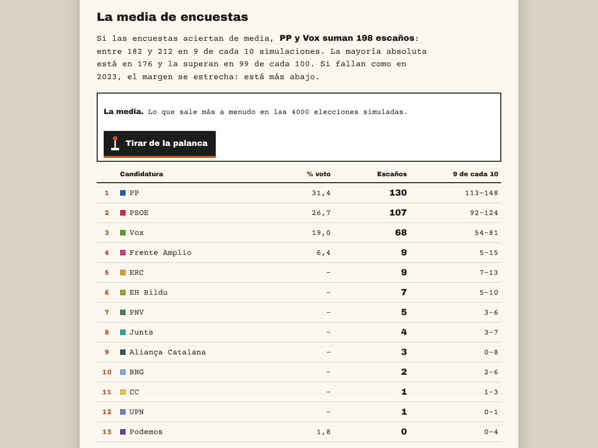
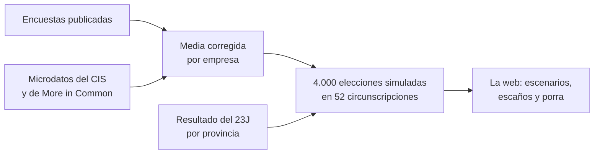

# Porra Electoral

**La media de las encuestas de las elecciones generales del 29 de noviembre de 2026, los escaños que salen de ella y una porra para jugar con amigos.**

### → [gastiaso.github.io/porra-electoral](https://gastiaso.github.io/porra-electoral/)

Cada semana se publican decenas de encuestas y cada una dice algo distinto. *Porra Electoral* las junta todas, corrige la tendencia propia de cada empresa a dar algo más o algo menos a ciertos partidos y simula 4.000 veces el reparto de los 350 escaños en las 52 circunscripciones. El resultado no es una cifra, sino un abanico: lo que sale si las encuestas aciertan de media y lo que cambia si se equivocan como otras veces.

No es una encuesta propia ni una casa de apuestas. Es un modelo hecho con las encuestas que publican otros, con el método, los datos y el código a la vista.

## Qué vas a encontrar

- **[La media de encuestas](https://gastiaso.github.io/porra-electoral/)**: cuántos escaños saca cada partido si las encuestas aciertan de media, con su margen; cómo ha evolucionado cada uno desde finales de septiembre; y quién se lleva el último escaño en cada provincia, en formato 1-X-2.
- **[Rellena tu porra](https://gastiaso.github.io/porra-electoral/porra.html)**: un juego sin dinero. Catorce duelos de escaños (1-X-2), un pleno al 15 y, si te atreves, el reparto de los 350 escaños. La porra se guarda en un enlace que puedes mandar por WhatsApp; con los enlaces de tus amigos montas una peña con clasificación, que se corrige sola la noche electoral.
- **[Elige tus supuestos](https://gastiaso.github.io/porra-electoral/supuestos.html)**: qué pasa si las encuestas fallan como en 2023, si acierta una empresa concreta o si aciertan las dos que publican sus microdatos (CIS y More in Common).
- **[Las encuestas](https://gastiaso.github.io/porra-electoral/encuestas.html)**: todas las encuestas que entran en la media, con empresa, medio, fechas de campo, muestra y fuente. Se pueden filtrar y ordenar.
- **[Las encuestadoras](https://gastiaso.github.io/porra-electoral/casas.html)**: una ficha por empresa con su forma de entrevistar y cuánto se separa su estimación de la de las demás.
- **[Cómo se calcula](https://gastiaso.github.io/porra-electoral/metodologia.html)** y **[Preguntas frecuentes](https://gastiaso.github.io/porra-electoral/preguntas.html)**: el método completo y las respuestas cortas.
- Después del 29 de noviembre, **¿En qué acertamos?**: la comparación con el resultado, salga como salga.

## Cómo leerlo

- **Es una media, no una encuesta.** No hay entrevistas propias: se parte de lo que publican las empresas y los medios.
- **Cada empresa tiene su sesgo.** Unas dan sistemáticamente algo más a un partido y otras algo menos. El modelo lo estima y lo corrige, con un supuesto que conviene tener presente: que, en conjunto, las empresas privadas no se equivocan hacia ningún lado. Es el supuesto que más pesa en el resultado.
- **«9 de cada 10» es el margen.** De las 4.000 elecciones simuladas, en 9 de cada 10 el partido cae dentro de ese rango. Incluye la posibilidad de que todas las encuestas fallen a la vez, como pasó en 2023 con el PSOE.
- **Los escenarios importan tanto como la media.** Si todas las encuestas se equivocan en la misma dirección, la media también. Por eso la web enseña qué pasa con otros supuestos, y no solo la cifra central.

> **No es una predicción cerrada.** Las cifras cambian con cada encuesta nueva y dependen de supuestos que están explicados en la web. Las conclusiones son provisionales.

## En qué se diferencia de otras medias

- **Corrige el sesgo de cada empresa** en lugar de promediar sin más, así que una empresa que publica muy a menudo no arrastra la media.
- **Recalcula el CIS y More in Common desde sus microdatos**, con el mismo método para las dos, en vez de usar la estimación que publican.
- **Convierte votos en escaños provincia a provincia**, con la ley D'Hondt y el umbral del 3 %, partiendo del resultado del 23J.
- **Está comprobada con elecciones pasadas.** Con las encuestas publicadas antes de las generales de noviembre de 2019 y de julio de 2023, el mismo método se desvió de media 1,1 y 1,5 puntos por partido. El margen de error se ajustó con esa comprobación.
- **Todo está a la vista**: las encuestas, los resultados del modelo y el código se pueden descargar y revisar.

## De dónde salen los datos

| Qué | Fuente |
|---|---|
| Encuestas publicadas | [Base de sondeos de Demócrata](https://www.democrata.es/elecciones-generales-espana/herramientas/encuestas), que enlaza cada estudio con su publicación original; las que no figuran allí, de la fuente que cita cada fila |
| CIS | Microdatos del barómetro de octubre (estudio 3582), recalculados; el preelectoral entrará cuando se publique |
| More in Common | Microdatos del *Pulso electoral*, recalculados |
| Resultados de 2023 | Ministerio del Interior (escrutinio del 23J, BOE-A-2023-18907) |
| Reparto provincial de Adelante Andalucía | Resultados de las elecciones andaluzas del 17 de mayo de 2026 |
| Comprobación con 2019 y 2023 | Encuestas de esas campañas recopiladas en Wikipedia |

## Calendario

- **Hasta el 23 de noviembre:** se actualiza a diario con las encuestas nuevas.
- **Del 24 al 28 de noviembre:** la ley electoral prohíbe publicar sondeos esos cinco días. La web se queda como estaba el 23 y no cambia.
- **29 de noviembre:** la porra se cierra a las 9:00. Tras el cierre de los colegios se cargan los resultados oficiales y las porras se corrigen solas.
- **Después:** evaluación pública del modelo, de los escenarios y de cada empresa.

## Cómo funciona

Todo el cálculo se hace en R; la web solo lee los resultados y no guarda datos de quien la visita: sin cookies, sin registro y sin analítica (GitHub Pages, que la aloja, puede registrar qué ficheros se descargan). El detalle está en [Cómo se calcula](https://gastiaso.github.io/porra-electoral/metodologia.html). Para repetir el cálculo, la guía está en [`docs/actualizar.md`](docs/actualizar.md).

## Limitaciones

- Si todas las encuestas fallan en la misma dirección, la media también falla. Los escenarios ayudan a ver cuánto, pero no lo evitan.
- El reparto provincial supone que el cambio desde 2023 se reparte de forma parecida entre provincias, con algo de variación aleatoria por comunidad y por provincia.
- Los partidos pequeños, como Podemos o SALF, tienen márgenes muy amplios: pocas encuestas los publican y unas décimas cambian si entran o no en el Congreso.
- Dos elecciones son pocos casos para ajustar el margen de error. Puede seguir siendo corto si un partido se hunde o despega en la última semana.

## Cómo citar

> Astiaso Llamazares, G. (2026). *Porra Electoral: media de encuestas y simulación de escaños, elecciones generales de 2026* [software y datos]. https://gastiaso.github.io/porra-electoral/. CC BY 4.0.

GitHub ofrece la cita en otros formatos (APA, BibTeX) desde el botón *Cite this repository*.

## Condiciones y licencia

- **Código:** [MIT](LICENSE).
- **Media, simulaciones, recálculos y textos de la web:** [CC BY 4.0](https://creativecommons.org/licenses/by/4.0/deed.es). Se pueden reutilizar con cualquier fin citando la autoría.
- **Cifras de cada encuesta:** son de sus autores y de los medios que las publican.
- **Microdatos del CIS y de More in Common:** no se redistribuyen; se descargan de sus webs, con sus condiciones.

Detalle en [`LICENCIA-DATOS.md`](LICENCIA-DATOS.md). La porra es un juego sin dinero y sin premios, sin relación con Loterías y Apuestas del Estado ni con ninguna casa de apuestas. El proyecto no tiene financiación, publicidad ni patrocinio.

## Contacto

Errores, dudas o encuestas que falten: por [LinkedIn](https://www.linkedin.com/in/guillermo-astiaso) o abriendo una [incidencia](https://github.com/gastiaso/porra-electoral/issues).

## Proyectos relacionados

- [Barómetro a barómetro](https://github.com/gastiaso/barometros): las series de los barómetros mensuales del CIS desde 2021, calculadas desde los microdatos.
- [Base de sondeos de Demócrata](https://www.democrata.es/elecciones-generales-espana/herramientas/encuestas): el archivo de encuestas electorales del que salen las cifras.
